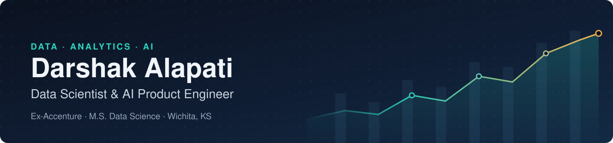
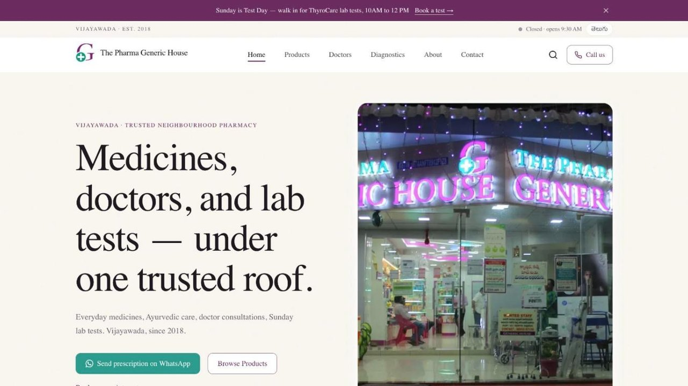
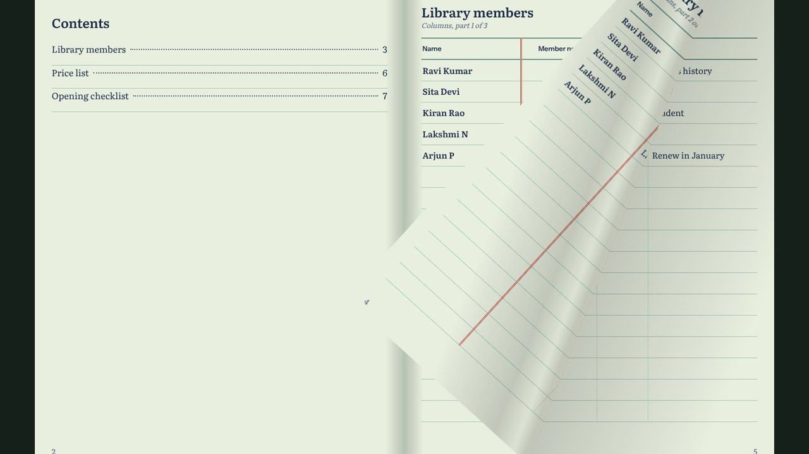

### Hi, I'm Darshak 👋

I build data pipelines and AI-powered products that real people use. Open to Data Science, Data Engineering and AI roles.

[Portfolio](https://darshakalapati.com) · [LinkedIn](https://linkedin.com/in/alapatidarshak) · [Resume](https://darshakalapati.com/Darshak_Alapati_Resume.pdf)

---

### What I do

- **Data engineering.** 3+ years at Accenture moving enterprise data for the Bath & Body Works migration: Control-M batch pipelines, Shell/Linux migration scripts and SQL source-to-target validation.
- **Analytics & ML.** Cleaning messy real-world data, statistical testing and turning results into decisions (M.S. Data Science).
- **Full-stack products.** I take ideas from schema to a live deployment: Next.js, Django, React, Supabase, PostgreSQL, Docker.
- **Applied AI.** LLM-powered tools and automation that take real work off people's plates.

---

### Featured work

<table>
<tr>
<td width="50%" valign="top">

**🏥 [The Pharma Generic House](https://github.com/Darshakalapati/The-Pharma-Generic-House)** · *in production*

Website and self-serve admin panel for a pharmacy in Vijayawada, India. Customers book doctor appointments and lab tests, browse a 4,000-item A–Z medicine directory and send enquiries straight to WhatsApp. Staff run everything without touching code.

`Next.js` `TypeScript` `Supabase` `PostgreSQL` `Tailwind` `Vercel`

→ [pharmagenerichouse.com](https://www.pharmagenerichouse.com)
</td>
<td width="50%" valign="top">

**📖 [Booklet View](https://github.com/Darshakalapati/booklet-view)**

Keep tables (ledgers, price lists, checklists) and read them as a book you can flip through. Wide tables continue across pages with the key column repeated, and pages curl under your finger on phones. Tables can be uploaded from Excel or CSV.

`Django` `React` `PostgreSQL` `Docker` `Render`
</td>
</tr>
<tr>
<td width="50%" valign="top">

**📊 JEE & NEET Question Bank** · *private*

Every JEE and NEET previous-year paper, shift by shift, collected into one clean, verified dataset with official answer keys. Cross-year analysis on top of it finds repeat patterns and topic weightage, so students know what to study first.

`Python` `Data engineering` `Analytics` · 270+ commits
</td>
<td width="50%" valign="top">

**🎬 Code-generated science films** · *private*

A pipeline that turns a script into a finished short film for JEE/NEET students, with every frame of the moving apparatus (a generator, an engine, a cell) drawn in code and synced to narration.

`Python` `JavaScript` `Automation` · 130+ commits
</td>
</tr>
</table>

**🧹 DataApps** · *in progress, team project* — a web platform for profiling, cleaning and mining uploaded datasets. `Spring Boot` `Python` `React`

The private projects are part of my work as co-founder of [MonkLearning](https://monklearning.com), an AI-teacher app for JEE/NEET students in India.

More, including the Kansas Board of Regents employment-outcomes study and an NYC Airbnb data-storytelling case study, is on my [portfolio](https://darshakalapati.com/#projects).

---

### Toolkit

- **Languages:** Python · SQL · TypeScript · JavaScript · Java · Shell
- **Data & ML:** machine learning · statistical analysis · EDA · Power BI · Excel
- **Backend & web:** Django · FastAPI · Spring Boot · Next.js · React
- **Data stores & cloud:** PostgreSQL · Supabase · AWS · Docker · Vercel · Render
- **AI:** generative AI · LLM applications · prompt engineering
- **Enterprise:** Control-M · Linux · CI/CD · UiPath
